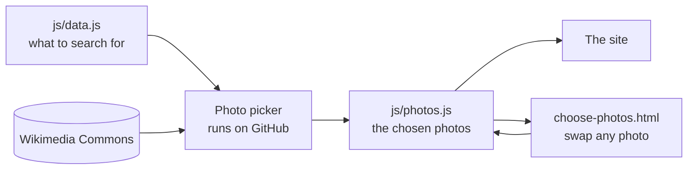

# hoilday

My 2027 trip site. Singapore wedding, then Europe.

Open `index.html` in a browser to see it. No install needed.

- Change trip info in `js/data.js` (stops, flights, places, checklist).
- Change colours in `css/style.css`.
- The map has three looks. Simple works offline. Streets and Satellite need the internet.

## Photos

Place photos come from Wikimedia Commons and need the internet to show.
They are picked once and saved in `js/photos.js`, so they don't change by themselves.

How a photo gets picked (`js/photo-rank.js`):

1. Search Commons three ways: Featured pictures (voted the best), Quality images
   (checked by reviewers), then everything.
2. Drop anything off topic. Every search word must be in the photo's name or categories,
   and "quoted names" must be there together. Big photos and gallery photos must also
   mention the place (its `where` names in `js/data.js`), so a Rathaus in Hannover can't
   end up on the Munich page. Paintings, maps, coins and flags are dropped too.
3. Score the rest. Top rated and on topic first, then wide shapes and big sizes.
   Close-ups, inside shots and old photos score lower for the big views. Food made in
   the place or its country comes first.
4. The gallery takes turns between its spots (a list in `js/data.js`), then runners up
   from the big photo and the things to do. So it shows the whole place and not ten
   photos of one building. No photo is used on two places.

Search words, as used in `js/data.js`:

| You write | It means |
| --- | --- |
| `Bacharach castle` | both words, anywhere in the photo's name or categories |
| `"Magere Brug"` | these words together |
| `Herengracht OR Prinsengracht` | either one |
| `intitle:Livigno` | the photo's own name must have it |

Changing things:

- **Add a place or change a search** in `js/data.js` and push. The "Pick photos" action
  fills in the new photos and commits `js/photos.js`. Until then the site finds some live.
- **Don't like a photo?** Open `choose-photos.html` (or tap "Swap photos" on a place page).
  Drop it or pick another, save over `js/photos.js`, then commit. Dropped photos are never
  picked again, and photos you pick by hand stay put.
- **Pick again from scratch:** run the "Pick photos" action from the Actions tab and type
  place ids like `venice rome`, or `all`. Or run `node tools/pick-photos.mjs --refresh venice`
  (needs Node 18 or newer).
